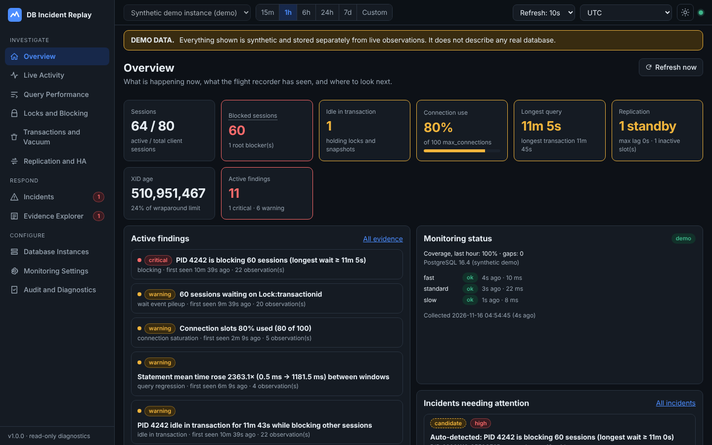

# DB Incident Replay

**Version 1.0.0: PostgreSQL production incident intelligence (read-only diagnostics)**

DB Incident Replay records what PostgreSQL was doing, so that when a production incident happens you can answer *what was observed, when, in what order, and what to look at next*, with every claim traceable to recorded evidence.

It is a **flight recorder plus an investigation workspace**, not another metrics dashboard:

1. **Detect:** a background recorder samples sessions, blocking, connections, database counters, replication, vacuum/XID state, settings and (optionally) the server log, and turns noteworthy conditions into **evidence** with first/last seen times.
2. **Collect and correlate:** evidence is stored with its source, thresholds and limitations; related evidence is linked structurally (same PID, statement, relation) and, more weakly, by time. Missing data is shown as *gaps*, never interpolated.
3. **Investigate:** an 11-page dashboard with an Evidence Explorer, a blocking graph that separates **root blockers** from direct blockers, query-performance trends from `pg_stat_statements`, vacuum/XID analysis, replication and slot analysis.
4. **Recommend:** each piece of evidence has a diagnostic card (observed → why it matters → impact → what to investigate → graded suggestions with risks). Suggestions are *informational*, *investigation required* or *potentially disruptive*. **Nothing is ever executed**; SQL is shown for you to run deliberately.
5. **Resolve and review:** incidents follow Detect → Collect → Correlate → Investigate → Recommend → Resolve → Review; findings carry an explicit confidence (observed / likely / hypothesis / confirmed) and reports separate facts from hypotheses.



> **Safety model.** The application never cancels queries, terminates sessions, changes configuration, creates indexes, restarts anything or fails over. Database connections are read-only with statement timeouts. Demo data is synthetic, labelled, and stored in a different file from live observations. See [SECURITY.md](SECURITY.md).

## What's in v1.0

| Area | What you get |
|---|---|
| Diagnostics engine | Activity, **root-vs-direct blocking graph** (Tarjan cycle detection, held/waited locks), connections, wait events, long queries and transactions, `pg_stat_statements` windows and regression hypotheses, vacuum pressure with context (xmin holders, running vacuums, table options), XID/multixact age, physical **and** logical replication slots, standby recovery state, archiver, checkpoints, configuration change detection, server-log parsing (deadlocks, lock waits, connection refusals, restarts) |
| Flight recorder | Three collection tiers (fast/standard/slow), bounded concurrency, non-overlapping runs, evidence lifecycle (new → escalated → cleared / stale), coverage and gap tracking, retention with dry run |
| Incident workflow | Automatic **candidates** from critical evidence (humans promote or dismiss), manual incidents, evidence linking, timeline notes, findings with confidence, Markdown/JSON reports, evidence snapshots |
| Dashboard | Overview · Live Activity · Query Performance · Locks and Blocking · Transactions and Vacuum · Replication and HA · Incidents · Evidence Explorer · Database Instances · Monitoring Settings · Audit and Diagnostics. Dark/light themes, time-zone selector, global time range with chart/timeline zoom, keyboard navigation, responsive layout |
| Security | Least-privilege role, TLS modes with an explicit "certificate not verified" warning, token auth with viewer/operator/admin roles, audit log, query-text redaction modes, CSP/security headers, formula-injection-safe CSV export |
| Preserved from v0.6 | Incident register, runbooks, log-excerpt ingestion, snapshot capture/history, evidence export, demo mode, and the v0.6 API paths (now served from the recorder) |

## Quick start (demo, no database needed)

```bash
python3 -m venv .venv && source .venv/bin/activate
pip install -r requirements.txt
cp .env.example .env            # DEMO_MODE=true is the default
python3 -m uvicorn app.main:app --host 127.0.0.1 --port 8000
```

Open <http://127.0.0.1:8000>. On first start the demo history (about two hours of synthetic data) is generated, which takes several seconds before the server begins accepting requests. Demo data repeats a 40-minute scenario: idle-in-transaction blocking pile-up, connection pressure, a slow statement, replication lag and an inactive logical slot.

## Monitor a real PostgreSQL instance

1. Create the least-privilege role: [`sql/00_monitoring_role.sql`](sql/00_monitoring_role.sql) (details in [docs/permissions.md](docs/permissions.md)). **Do not use a superuser.**
2. Edit `.env`: `DEMO_MODE=false`, `DB_HOST/PORT/NAME/USER/PASSWORD`, and for anything remote `DB_SSLMODE=verify-full` with `DB_SSLROOTCERT`.
3. Optional but valuable: `pg_stat_statements` (query performance) and `PG_LOG_FILE` (deadlock and lock-wait details). See [docs/query-performance.md](docs/query-performance.md) and [docs/postgres-logging.md](docs/postgres-logging.md).
4. Start the app (command above). Open **Database Instances** to see which capabilities are available and exactly why any are not.
5. If the app is reachable by anyone but you, set `AUTH_MODE=token` and put it behind a TLS-terminating reverse proxy ([SECURITY.md](SECURITY.md)).

Several instances: set `INSTANCES_FILE` ([.env.example](.env.example)). Passwords come from environment variables, never from the JSON file.

## Run the tests

```bash
pip install -r requirements-dev.txt
pytest -m "not live and not e2e"        # unit + API tests; no database or browser needed
bash scripts/lab_setup.sh               # (Debian/Ubuntu, root) disposable PostgreSQL lab for live tests
bash scripts/lab_standby.sh             # optional: adds a physical standby on port 5433
playwright install chromium             # optional: browser end-to-end tests
pytest                                  # everything; live/e2e tests skip themselves when their prerequisites are missing
```

What was actually executed, and what was not, is in [docs/VALIDATION.md](docs/VALIDATION.md). In short: **PostgreSQL 16.15 only** (primary and a streaming standby); other versions are covered by version-gated SQL unit tests, not live runs.

## Documentation

| | |
|---|---|
| [docs/ENGINEERING_ASSESSMENT.md](docs/ENGINEERING_ASSESSMENT.md) | What v0.6 did, its weaknesses, and what changed |
| [docs/architecture.md](docs/architecture.md) | Components, data flow, storage, design decisions |
| [docs/flight-recorder.md](docs/flight-recorder.md) | Tiers, evidence lifecycle, thresholds, retention, demo isolation |
| [docs/incident-workflow.md](docs/incident-workflow.md) | Stages, candidates, confidence labels, reports |
| [docs/permissions.md](docs/permissions.md) | Role SQL and the privilege each diagnostic needs |
| [docs/compatibility.md](docs/compatibility.md) | PostgreSQL 12-17 feature gating; what was executed |
| [docs/api.md](docs/api.md) | Endpoint reference |
| [docs/VALIDATION.md](docs/VALIDATION.md) | Honest validation report |
| [docs/upgrading-from-0.6.md](docs/upgrading-from-0.6.md) | Migration and compatibility notes |
| [docs/troubleshooting.md](docs/troubleshooting.md) · [docs/roadmap.md](docs/roadmap.md) | Operations and product direction |

## Honest capability boundaries

| Capability | v1.0.0 status |
|---|---|
| Live diagnostics, evidence, blocking graph, vacuum/XID, replication, query windows | Implemented and executed against PostgreSQL 16.15 |
| Standby-side and primary-side replication views | Executed against a real physical primary + standby (PostgreSQL 16.15) |
| PostgreSQL 12-15 and 17 | SQL is version-gated and unit-tested; **not executed** |
| Logical replication (subscriptions, logical slots) | Collected and analysed; **not executed against a real logical setup** (only synthetic data and unit tests) |
| Patroni / repmgr state | Optional Patroni REST read; **not tested against a real cluster**. Without it the UI says cluster-manager state is unavailable |
| Server log parsing | `stderr` text format only; csvlog/jsonlog are not parsed |
| Historical blocking | Only what was captured while it happened (sampling interval 15 s by default). Blocking shorter than the interval can be missed |
| Query plans, OS metrics (CPU, memory, disk) | Not collected |
| Root-cause analysis | Not claimed. Evidence is observed fact; explanations are labelled hypotheses |
| Automatic remediation | Intentionally not implemented |
| Authentication | Static bearer tokens with three roles. No SSO/OIDC, no rate limiting |
| Container image / Windows / macOS | Provided or expected to work, **not tested here** |

Python 3.11+ is required (developed and tested on 3.12).

## License

See [LICENSE](LICENSE).
